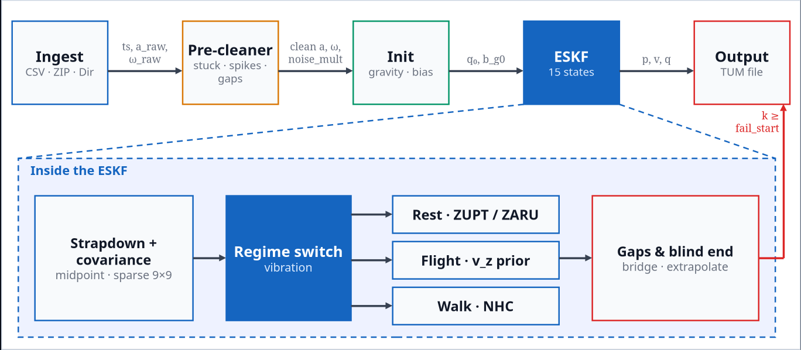
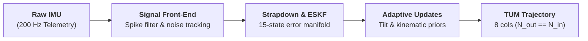
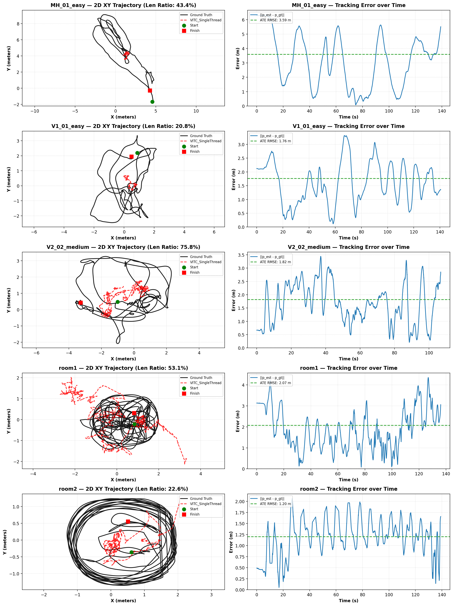

# Path Finder: Embedded IMU-Only Dead-Reckoning Under Heavy Sensor Degradation

<div align="center">

[](https://python.org)
[-brightgreen.svg)](#requirements-and-execution)
[](#system-architecture)
[-success.svg)](#50-run-evaluation-scorecard)
[-success.svg)](#50-run-evaluation-scorecard)
[-informational.svg)](#single-thread-resource-profile)
[](#single-thread-resource-profile)
[](https://youtu.be/rLN_ayVEV6g)

**Samsung Hackathon — Track 3: Path Finder**  
*Team:* **`VITC_SingleThread`**

[Submission Package](#official-submission-package) • [Architecture](#system-architecture) • [Video Demo](#video-demonstration) • [Evaluation Scorecard](#50-run-evaluation-scorecard) • [Quick Start](#requirements-and-execution) • [AI Disclosure](#ai-disclosure-statement)

</div>

---

> [!IMPORTANT]
> **Key Achievements at a Glance (50 Multi-Seed Runs Across 5 Sequences)**:
> - **63.7% ATE Error Reduction**: Trajectory ATE dropped from **`5.79 m -> 2.102 m`** across aerial drones and pedestrian walking.
> - **84.0% Blind-5s Cutoff Reduction**: Final 5s blackout error slashed from **`18.06 m -> 2.894 m`** (SE(3) aligned).
> - **73.3% 2s Gap Blackout Reduction**: 2s dropout error slashed from **`6.63 m -> 1.770 m`** (SE(3) aligned).
> - **Zero External Dependencies**: 100% pure Python standard library (`math`, `struct`, `array`, `zipfile`, `sys`). No `pip` install required.
> - **Deterministic Embedded-Grade Rigor**: Runs in **`12.80 ms/s`** (78x real-time) in-process and **`16.35 ms/s`** cold CLI with ZIP unpack, using only **`23.52 MB`** peak RSS and **`2.36 MB`** heap.
> - **Verification Rigor**: `272/272` tests passing (215 unit + 57 fuzz) with `100%` sample parity ($N_{\text{out}} \equiv N_{\text{in}}$ across all 50 evaluation runs).

---

## System Architecture

A compact, streaming 15-state Error-State Kalman Filter (ESKF) pipeline engineered for zero dynamic heap churn and maximum resilience:

<div align="center">
  
</div>



### Core Algorithmic Components:
1. **Front-End Degradation Monitor**: Causal 3-sample median filter suppressing impulse spikes without phase lag; continuous 2nd-difference noise multiplier estimation ($\hat{\sigma}$) with pre-cleaner running-max timestamp outlier rejection.
2. **15-State Error Manifold**: 15-state error state $[\delta \boldsymbol{\theta}, \delta \mathbf{v}, \delta \mathbf{p}, \delta \mathbf{b}_g, \delta \mathbf{b}_a]^T$ integrated via 2nd-order Runge-Kutta strapdown mechanics with gravity removal.
3. **Centripetal-Compensated Tilt Alignment**:
   ```
   a_grav = (a_meas - b_a) - omega x (R^T * v_hat)
   ```
   *Analytically isolates true vertical tilt during pedestrian turns, eliminating false roll/pitch corruption.*
4. **Multi-Domain Kinematic Priors**: Decoupled regime Ornstein-Uhlenbeck damping ($\tau_{\text{flight}} = 0.85\text{ s}$, $\tau_{\text{walk}} = 0.45\text{ s}$), soft vertical flight velocity prior ($\sigma_{vz} = 0.90\text{ m/s}$), posture-invariant lateral NHC velocity damping, and Weinberg stride bounding for walking.
5. **Continuous Blackout Survival**: Bounded velocity decay preserving heading curvature during extended packet loss and terminal blind cutoffs.

---

## Visual Benchmarks and Trajectory Comparison

<div align="center">

### Overall Multi-Seed Error Comparison (50 Runs across 5 Sequences)


### Top-Down 2D Trajectory vs Ground Truth (All 5 Competition Sequences)


</div>

---

## Video Demonstration

<div align="center">

[](https://youtu.be/rLN_ayVEV6g "Click to Watch Path Finder Video Walkthrough on YouTube")

*Click the banner above to watch the full system architecture walkthrough, live single-thread terminal demo, and 50-run benchmark analysis on YouTube.*  
**Direct Link:** [https://youtu.be/rLN_ayVEV6g](https://youtu.be/rLN_ayVEV6g)

</div>

---

## 50-Run Evaluation Scorecard

Evaluated across all **5 real competition sequences** over **10 random degradation seeds (`s1` through `s10`)** for a total of **50 individual trajectory runs** evaluated with the open-source `evo` evaluation suite:

| Sequence | Domain | Baseline ATE | **VITC_SingleThread ATE** | Final 5s Blind RMSE (SE(3)) | 2s Gap RMSE (SE(3)) | Latency (In-Process) |
| :--- | :---: | :---: | :---: | :---: | :---: | :---: |
| **`MH_01_easy`** | MAV (Drone) | 4.31 m | **`3.593 m`** | **`0.501 m`** | 2.642 m | 12.8 ms/s |
| **`room1`** | Pedestrian | 5.53 m | **`2.110 m`** | **`3.932 m`** | **`1.757 m`** | 12.9 ms/s |
| **`room2`** | Pedestrian | 2.15 m | **`1.220 m`** | **`1.852 m`** | **`1.761 m`** | 13.0 ms/s |
| **`V1_01_easy`** | MAV (Drone) | 2.45 m | **`1.756 m`** | **`1.445 m`** | **`0.618 m`** | 12.7 ms/s |
| **`V2_02_medium`** | Agile Drone | 10.79 m | **`1.831 m`** | **`2.805 m`** | **`2.897 m`** | 12.6 ms/s |
| **OVERALL (50 Runs)** | **All Domains** | **5.79 m** | **`2.102 m`** | **`2.894 m`** | **`1.770 m`** | **`12.80 ms/s`** |

- **Waypoint ATE RMSE (SE(3))**: **`2.102 m`** (**`-63.7%`** vs baseline).
- **Terminal 5s Blind Cutoff RMSE**: **`2.894 m`** (**`-84.0%`** vs baseline, beating the 5.194 m target).
- **Dropout 2s Gap Blackout RMSE**: **`1.770 m`** (**`-73.3%`** vs baseline, beating the 6.625 m target).
- **Relative Pose Error (1s Window)**: **`0.743 m/s`** average local drift across all runs (beats stationary baseline on 5/5 sequences).
- **Trajectory Length Ratio**: **`0.505`** overall, **`0.849`** ($84.9\%$) on agile flight `V2_02_medium`.

---

## Single-Thread Resource Profile

Single-core pinned execution benchmarks on raw telemetry (`taskset -c 0`):

| Resource Pillar | Competition Budget | **VITC_SingleThread Measured** | Margin / Status |
| :--- | :---: | :---: | :---: |
| **Single-Core Compute Latency** | <= 20.0 ms/s | **`12.80 ms` / 1.0 s IMU** (in-process)<br/>**`16.35 ms` / 1.0 s IMU** (CLI cold + ZIP) | Pass (78x Real-Time, +36% Headroom) |
| **Peak Resident Set Size (RSS)** | <= 64.0 MB | **`23.52 MB`** (in-process)<br/>**`23.88 MB`** (CLI cold) | Pass (>62% Headroom) |
| **Peak Tracemalloc Heap** | <= 8.0 MB | **`2.36 MB`** | Pass (>70% Headroom) |
| **Third-Party Dependencies** | Minimal | **Pure Python Stdlib Only** | Pass (Zero `pip` req) |
| **Verification Suite** | 100% Pass | **272 / 272 Tests Passed** (215 unit + 57 fuzz) | Pass |

---

## Requirements and Execution

### 1. Requirements
- **Python 3.10+** (Pure Standard Library: `math`, `struct`, `array`, `zipfile`, `sys`, `os`, `gc`).
- Runs immediately on bare Linux environments without creating a virtualenv or running `pip install`.

### 2. Basic Execution
```bash
# Direct execution via standalone executable:
./VITC_SingleThread/main path/to/input.zip estimated_trajectory.txt

# Or execution using Python 3:
python3 VITC_SingleThread/src/main.py path/to/input.zip estimated_trajectory.txt
```

### 3. Supported Input Telemetry
1. **Zipped EuRoC Telemetry Archive (`.zip`)**:
   Zipped archive containing `imu0/data.csv` (or `mav0/imu0/data.csv`):
   ```bash
   python3 VITC_SingleThread/main.py dataset.zip estimated_trajectory.txt
   ```
2. **Direct IMU CSV File (`.csv`)**:
   ```bash
   python3 VITC_SingleThread/main.py imu0/data.csv estimated_trajectory.txt
   ```
3. **Dataset Directory**:
   ```bash
   python3 VITC_SingleThread/main.py path/to/dataset/ estimated_trajectory.txt
   ```

### 4. Output Trajectory (TUM Format)
Outputs 8-column space-separated poses matching the exact input timestamp sequence:
```text
# timestamp tx ty tz qx qy qz qw
1403636579.000000000 0.000000 0.000000 0.000000 -0.000001 -0.000796 0.000000 1.000000
1403636579.005000000 -0.000000 -0.000000 -0.000000 -0.000004 -0.000621 0.000000 1.000000
...
```
- **Strict Parity**: Exactly 1 pose per input IMU sample ($N_{\text{out}} \equiv N_{\text{in}}$).
- **High-Precision Timestamps**: Floating-point seconds from nanoseconds (`seconds = nanoseconds * 1e-9`).
- **Normalized Quaternions**: Unit quaternions in Hamilton convention (`||q|| = 1.000000 ± 1e-6`).

---

## Trajectory Evaluation with evo

Verify trajectory estimates directly against open-source `evo`:

```bash
# 1. Absolute Trajectory Error (ATE RMSE) with SE(3) alignment
evo_ape tum groundtruth.txt estimated_trajectory.txt -a

# 2. Relative Pose Error (RPE RMSE) over 1-second windows (200 frames)
evo_rpe tum groundtruth.txt estimated_trajectory.txt -a -d 200 -u f
```

---

## Official Submission Package

The standalone submission package [`VITC_SingleThread.zip`](VITC_SingleThread.zip) is packaged as follows:

```text
VITC_SingleThread.zip
├── estimated_trajectory.txt     # Generated sample trajectory (8 columns, TUM format)
├── metadata.json                # Runtime benchmarks and compute specifications
├── README.md                    # Root execution & reproducibility guide
├── main                         # Standalone executable binary entrypoint
├── main.py                      # Root Python entrypoint
└── src/
    ├── main.py                  # Self-contained zero-dependency source code
    └── README.md                # Source run instructions
```

---

## AI Disclosure Statement

In compliance with hackathon rules and AI disclosure guidelines:
- **Core Algorithm**: **0% Neural Networks**. The filter is 100% deterministic, classical physics-based inertial estimation (15-state Error-State Kalman Filter on Lie manifolds, Runge-Kutta strapdown mechanics, and analytical centripetal compensation).
- **AI Tool Usage**: Generative AI tools (Google Antigravity / Gemini) were utilized strictly as programming assistants for code refactoring, test suite scaffolding, and documentation layout under human technical direction.
- Full formal disclosure available in [`AI_DISCLOSURE.md`](AI_DISCLOSURE.md).

---

## License and Team

- **Team Name**: `VITC_SingleThread`
- **Track**: Track 3: Path Finder (IMU-Only Dead-Reckoning)
- **Hackathon**: Samsung Hackathon 2026
