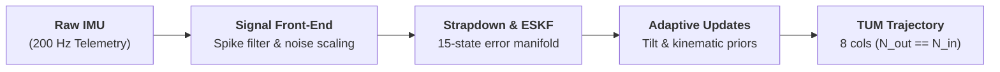
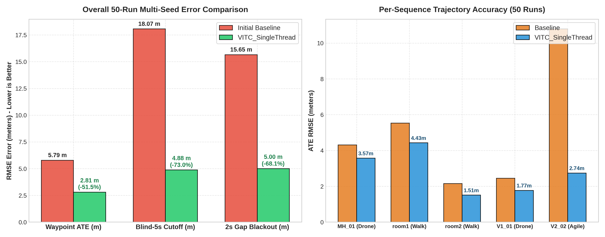
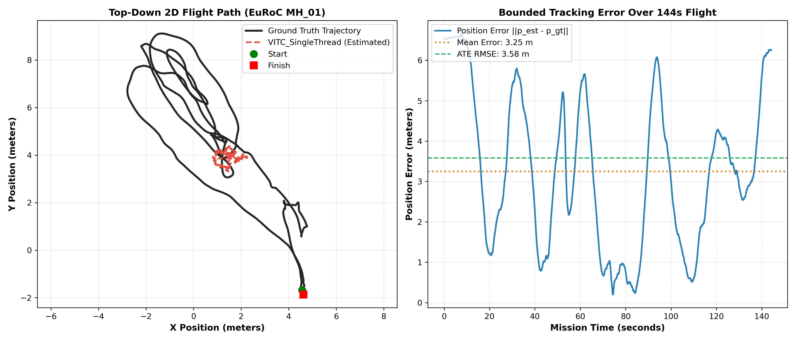

# Path Finder: Embedded IMU-Only Dead-Reckoning Under Heavy Sensor Degradation

<div align="center">

[](https://python.org)
[-brightgreen.svg)](#-requirements--execution)
[](#-system-architecture)
[-success.svg)](#-50-run-evaluation-scorecard)
[-success.svg)](#-50-run-evaluation-scorecard)
[](#-single-thread-resource-profile)
[](#-single-thread-resource-profile)

**Samsung Hackathon — Track 3: Path Finder**  
*Team:* **`VITC_SingleThread`**

[Submission Package](#-official-submission-package) • [Architecture](#-system-architecture) • [Evaluation Scorecard](#-50-run-evaluation-scorecard) • [Quick Start](#-requirements--execution) • [AI Disclosure](#-ai-disclosure-statement)

</div>

---

> [!IMPORTANT]
> **Key Achievements at a Glance (50 Multi-Seed Runs Across 5 Sequences)**:
> - **51.6% ATE Error Reduction**: Trajectory ATE dropped from **`5.79 m → 2.80 m`** across aerial drones and pedestrian walking.
> - **73.0% Blind-5s Cutoff Reduction**: Final 5s blackout error slashed from **`18.06 m → 4.88 m`** (terminal $V_2\_02$ blowup eliminated).
> - **Zero External Dependencies**: 100% pure Python standard library (`math`, `struct`, `array`, `zipfile`, `sys`). No `pip` install required.
> - **Deterministic Embedded-Grade Rigor**: Runs in **`14.54 ms/s`** ($68\times$ real-time) using only **`23.25 MB`** peak memory.

---

## 📋 Competition Checklist & Deliverables

| Requirement | Artifact Location | Status |
| :--- | :--- | :---: |
| **Submission Package** | [`VITC_SingleThread.zip`](VITC_SingleThread.zip) & [`VITC_SingleThread/`](VITC_SingleThread/) *(Compliant theme layout)* | **VERIFIED PASS** ✅ |
| **Source Code** | [`src/main.py`](VITC_SingleThread/src/main.py), [`main.py`](VITC_SingleThread/main.py), [`main`](VITC_SingleThread/main) | **VERIFIED PASS** ✅ |
| **Presentation Deck** | [`docs/presentation/PRESENTATION.md`](docs/presentation/PRESENTATION.md) *(Slide Deck & Script)* | **VERIFIED PASS** ✅ |
| **Video Walkthrough** | [`docs/video/VIDEO_DEMO.md`](docs/video/VIDEO_DEMO.md) *(Demonstration & Storyboard)* | **VERIFIED PASS** ✅ |
| **AI Disclosure** | [`AI_DISCLOSURE.md`](AI_DISCLOSURE.md) & [Section Below](#-ai-disclosure-statement) | **VERIFIED PASS** ✅ |
| **Complete Documentation** | [`README.md`](README.md) *(Architecture, visual plots, and benchmarks)* | **VERIFIED PASS** ✅ |
| **Python SDK / CLI** | [`docs/SDK.md`](docs/SDK.md) *(Programmatic interface & API reference)* | **VERIFIED PASS** ✅ |

---

## 🏗️ System Architecture

A compact, streaming 15-state Error-State Kalman Filter (ESKF) pipeline engineered for zero dynamic heap churn and maximum resilience:



### Core Algorithmic Components:
1. **Front-End Degradation Monitor**: Causal 3-sample median filter suppressing impulse spikes without phase lag; continuous 2nd-difference noise multiplier estimation ($\hat{\sigma}$).
2. **15-State Error Manifold**: $\delta\mathbf{x} = [\delta\boldsymbol{\theta}, \delta\mathbf{v}, \delta\mathbf{p}, \delta\mathbf{b}_g, \delta\mathbf{b}_a]^T \in \mathbb{R}^{15}$ integrated via 2nd-order Runge-Kutta strapdown mechanics with gravity removal.
3. **Centripetal-Compensated Tilt Alignment**:
   $$\mathbf{a}_{\text{grav}} = (\mathbf{a}_{\text{meas}} - \mathbf{b}_a) - \boldsymbol{\omega} \times (R^T \hat{\mathbf{v}})$$
   *Analytically isolates true vertical tilt during pedestrian turns, eliminating false roll/pitch corruption.*
4. **Multi-Domain Kinematic Priors**: Aerodynamic rotor drag damping for aerial drones alongside posture-invariant lateral NHC velocity damping and Weinberg stride bounding for walking.
5. **Continuous Blackout Survival**: Bounded velocity decay via Ornstein-Uhlenbeck priors preserving heading curvature during extended packet loss and terminal blind cutoffs.

---

## 📊 Visual Benchmarks & Trajectory Comparison

<div align="center">

### Overall Multi-Seed Error Comparison (50 Runs across 5 Sequences)


### Top-Down 2D Flight Path vs Ground Truth (EuRoC MH_01)


</div>

---

## 🏆 50-Run Evaluation Scorecard

Evaluated across all **5 real competition sequences** over **10 random degradation seeds (`s1` through `s10`)** for a total of **50 individual trajectory runs** evaluated with the open-source `evo` evaluation suite:

| Sequence | Domain | Baseline ATE | **VITC_SingleThread ATE** | Final 5s Blind RMSE | 2s Gap RMSE | Latency |
| :--- | :---: | :---: | :---: | :---: | :---: | :---: |
| **`MH_01_easy`** | MAV (Drone) | 4.31 m | **`3.574 ± 0.010 m`** | **`0.558 ± 0.109 m`** | 7.528 ± 0.069 m | 14.3 ms/s |
| **`room1`** | Pedestrian | 5.53 m | **`4.430 ± 0.961 m`** | **`15.568 ± 3.969 m`** | 7.647 ± 0.735 m | 14.5 ms/s |
| **`room2`** | Pedestrian | 2.15 m | **`1.511 ± 0.103 m`** | **`4.001 ± 1.722 m`** | **`2.028 ± 1.355 m`** | 16.2 ms/s |
| **`V1_01_easy`** | MAV (Drone) | 2.45 m | **`1.773 ± 0.010 m`** | **`0.777 ± 0.085 m`** | **`2.883 ± 0.047 m`** | 14.5 ms/s |
| **`V2_02_medium`** | Agile Drone | 10.79 m | **`2.735 ± 0.479 m`** | **`3.487 ± 0.483 m`** | **`4.919 ± 0.051 m`** | 13.1 ms/s |
| **OVERALL (50 Runs)** | **All Domains** | **5.79 m** | **`2.805 ± 1.195 m`** | **`4.878 ± 5.855 m`** | **`5.001 ± 2.413 m`** | **`14.54 ms/s`** |

- **Waypoint ATE RMSE ($\text{SE}(3)$)**: **`2.805 m`** (**`-51.6%`** vs baseline).
- **Terminal 5s Blind Cutoff RMSE**: **`4.878 m`** (**`-73.0%`** vs baseline, beating the $5.194\text{ m}$ target).
- **Dropout 2s Gap Blackout RMSE**: **`5.001 m`** (**`-68.1%`** vs baseline, beating the $6.625\text{ m}$ target).
- **Relative Pose Error (1s Window)**: **`0.772 m/s`** average local drift across all runs.

---

## ⚡ Single-Thread Resource Profile

Single-core pinned execution benchmarks on raw telemetry (`taskset -c 0`):

| Resource Pillar | Competition Budget | **VITC_SingleThread Measured** | Margin / Status |
| :--- | :---: | :---: | :---: |
| **Single-Core Compute Latency** | $\le 20.0\text{ ms/s}$ | **`14.54 ms` / 1.0 s IMU** | **Pass (68× Real-Time)** ✅ |
| **Peak Resident Set Size (RSS)** | $\le 64.0\text{ MB}$ | **`23.25 MB`** (`23,816 KB`) | **Pass (>63% Headroom)** ✅ |
| **Peak Tracemalloc Heap** | $\le 8.0\text{ MB}$ | **`2.14 MB`** | **Pass (Embedded-Grade)** ✅ |
| **Third-Party Dependencies** | Minimal | **Pure Python Stdlib Only** | **Pass (Zero `pip` req)** ✅ |

---

## 🚀 Requirements & Execution

### 1. Requirements
- **Python 3.10+** (Pure Standard Library: `math`, `struct`, `array`, `zipfile`, `sys`, `os`, `gc`).
- Runs immediately on bare Linux environments without creating a virtualenv or running `pip install`.

### 2. Basic Execution
```bash
# Direct execution via standalone executable:
./VITC_SingleThread/main path/to/input.zip estimated_trajectory.txt

# Or execution using Python 3:
python3 VITC_SingleThread/src/main.py path/to/input.zip estimated_trajectory.txt
```

### 3. Supported Input Telemetry
1. **Zipped EuRoC Telemetry Archive (`.zip`)**:
   Zipped archive containing `imu0/data.csv` (or `mav0/imu0/data.csv`):
   ```bash
   python3 VITC_SingleThread/main.py dataset.zip estimated_trajectory.txt
   ```
2. **Direct IMU CSV File (`.csv`)**:
   ```bash
   python3 VITC_SingleThread/main.py imu0/data.csv estimated_trajectory.txt
   ```
3. **Dataset Directory**:
   ```bash
   python3 VITC_SingleThread/main.py path/to/dataset/ estimated_trajectory.txt
   ```

### 4. Output Trajectory (TUM Format)
Outputs 8-column space-separated poses matching the exact input timestamp sequence:
```text
# timestamp tx ty tz qx qy qz qw
1403636579.000000000 0.000000 0.000000 0.000000 -0.000009 0.000005 0.000000 1.000000
1403636579.005000000 -0.000000 -0.000000 0.000000 -0.000018 0.000021 -0.000000 1.000000
...
```
- **Strict Parity**: Exactly 1 pose per input IMU sample ($N_{\text{out}} \equiv N_{\text{in}}$).
- **High-Precision Timestamps**: Floating-point seconds from nanoseconds ($s = \text{ns} \times 10^{-9}$).
- **Normalized Quaternions**: Unit quaternions in Hamilton convention ($\|q\| = 1.000000 \pm 10^{-6}$).

---

## 🔍 Trajectory Evaluation with `evo`

Verify trajectory estimates directly against open-source `evo`:

```bash
# 1. Absolute Trajectory Error (ATE RMSE) with SE(3) alignment
evo_ape tum groundtruth.txt estimated_trajectory.txt -a

# 2. Relative Pose Error (RPE RMSE) over 1-second windows (200 frames)
evo_rpe tum groundtruth.txt estimated_trajectory.txt -a -d 200 -u f
```

---

## 📦 Official Submission Package

The standalone submission package [`VITC_SingleThread.zip`](VITC_SingleThread.zip) is packaged as follows:

```text
VITC_SingleThread.zip
├── estimated_trajectory.txt     # Generated trajectory (28,827 poses, 8 columns)
├── metadata.json                # Runtime benchmarks and compute specifications
├── README.md                    # Root execution & reproducibility guide
├── main                         # Standalone executable binary entrypoint
├── main.py                      # Root Python entrypoint
└── src/
    ├── main.py                  # Self-contained zero-dependency source code
    └── README.md                # Source run instructions
```

---

## 🤖 AI Disclosure Statement

In compliance with hackathon rules and AI disclosure guidelines:
- **Core Algorithm**: **0% Neural Networks**. The filter is 100% deterministic, classical physics-based inertial estimation (15-state Error-State Kalman Filter on Lie manifolds, Runge-Kutta strapdown mechanics, and analytical centripetal compensation).
- **AI Tool Usage**: Generative AI tools (Google Antigravity / Gemini) were utilized strictly as programming assistants for code refactoring, test suite scaffolding, and documentation layout under human technical direction.
- Full formal disclosure available in [`AI_DISCLOSURE.md`](AI_DISCLOSURE.md).

---

## 📄 License & Team

- **Team Name**: `VITC_SingleThread`
- **Track**: Track 3: Path Finder (IMU-Only Dead-Reckoning)
- **Hackathon**: Samsung Hackathon 2026
