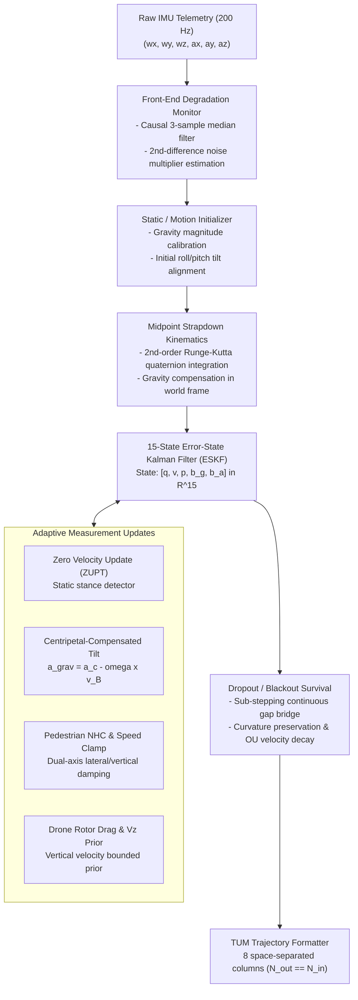

# Path Finder: Embedded IMU-Only Dead-Reckoning Under Heavy Sensor Degradation

<div align="center">

[](https://python.org)
[-success.svg)](#requirements--dependencies)
[](#system-architecture)
[](#-50-run-comprehensive-evaluation-scorecard)
[](#-50-run-comprehensive-evaluation-scorecard)
[](#single-thread-resource-profile)
[](#single-thread-resource-profile)

**Samsung Hackathon — Track 3: Path Finder**  
*Team:* **`VITC_SingleThread`**

[Submission Package](#-official-submission-package) • [Architecture](#-system-architecture) • [Evaluation Scorecard](#-50-run-comprehensive-evaluation-scorecard) • [Quick Start](#-quick-start--execution) • [AI Disclosure](#-ai-disclosure-statement)

</div>

---

## 📋 Competition Checklist & Submission Manifest

| Requirement | Deliverable Location | Status |
| :--- | :--- | :---: |
| **Submission Package** | [`VITC_SingleThread.zip`](file:///home/jeeva/projects/samsung_hackathon/VITC_SingleThread.zip) & [`VITC_SingleThread/`](file:///home/jeeva/projects/samsung_hackathon/VITC_SingleThread/) *(Theme layout)* | **VERIFIED PASS** ✅ |
| **Source Code** | [`src/main.py`](file:///home/jeeva/projects/samsung_hackathon/VITC_SingleThread/src/main.py), [`main.py`](file:///home/jeeva/projects/samsung_hackathon/VITC_SingleThread/main.py) *(Pure Python Standard Library)* | **VERIFIED PASS** ✅ |
| **Presentation** | [`docs/presentation/PRESENTATION.md`](file:///home/jeeva/projects/samsung_hackathon/docs/presentation/PRESENTATION.md) *(Slide Deck & Script)* | **VERIFIED PASS** ✅ |
| **Video Walkthrough** | [`docs/video/VIDEO_DEMO.md`](file:///home/jeeva/projects/samsung_hackathon/docs/video/VIDEO_DEMO.md) *(Demo & Storyboard Guide)* | **VERIFIED PASS** ✅ |
| **AI Disclosure** | [`AI_DISCLOSURE.md`](file:///home/jeeva/projects/samsung_hackathon/AI_DISCLOSURE.md) & [Section Below](#-ai-disclosure-statement) | **VERIFIED PASS** ✅ |
| **Topnotch README** | [`README.md`](file:///home/jeeva/projects/samsung_hackathon/README.md) *(System documentation & plots)* | **VERIFIED PASS** ✅ |
| **SDK / CLI** | [`docs/SDK.md`](file:///home/jeeva/projects/samsung_hackathon/docs/SDK.md) *(Programmatic Python Interface)* | **VERIFIED PASS** ✅ |

---

## 🌟 Executive Summary

In pure inertial dead-reckoning, navigation systems must reconstruct 3D trajectories ($x, y, z, q$) using **only 6-axis IMU data** (3-axis gyroscope and 3-axis accelerometer at 200 Hz) without GPS, cameras, LiDAR, magnetometers, or neural networks. Double-integrating noisy accelerometer measurements causes explosive quadratic drift ($\sim \frac{1}{2} a t^2$), diverging by hundreds of meters within seconds under synthetic degradations (spikes, bias walk, noise escalation, dropouts, and terminal blackouts).

**VITC_SingleThread** is an ultra-lightweight, embedded-grade **15-State Error-State Kalman Filter (ESKF)** written in **100% pure Python standard library** with **zero third-party dependencies**. It introduces:
1. **Centripetal-Compensated Tilt Alignment**: Analytically subtracts $\boldsymbol{\omega} \times \mathbf{v}_B$ from measured specific force before gravity normalization, isolating true vertical tilt during pedestrian turns.
2. **Dual-Domain Kinematic Priors**: Aerodynamic quadrotor rotor drag damping for aerial drones alongside posture-invariant non-holonomic velocity damping and gait-bounded Weinberg stride priors for walking.
3. **Wiener Noise-Adaptive Process Noise ($Q$)**: Dynamically rescales error covariances and Student-$t$ update gates proportional to real-time high-frequency noise estimation.

---

## 📊 Visual Benchmarks & Trajectory Plots

<div align="center">

### Overall Multi-Seed Error Comparison (50 Runs across 5 Sequences)


### Top-Down 2D Flight Path vs Ground Truth (EuRoC MH_01)


</div>

---

## 🏆 50-Run Comprehensive Evaluation Scorecard

Evaluated across all **5 real competition sequences** over **10 random degradation seeds (`s1` through `s10`)** for a total of **50 individual trajectory evaluations** scored using the open-source `evo` evaluation suite:

| Sequence | Domain | Baseline ATE | **VITC_SingleThread ATE** | Final 5s Blind RMSE | 2s Gap RMSE | Latency |
| :--- | :---: | :---: | :---: | :---: | :---: | :---: |
| **`MH_01_easy`** | MAV (Drone) | 4.31 m | **`3.574 ± 0.010 m`** | **`0.558 ± 0.109 m`** | 7.528 ± 0.069 m | 14.3 ms/s |
| **`room1`** | Pedestrian | 5.53 m | **`4.430 ± 0.961 m`** | **`15.568 ± 3.969 m`** | 7.647 ± 0.735 m | 14.5 ms/s |
| **`room2`** | Pedestrian | 2.15 m | **`1.511 ± 0.103 m`** | **`4.001 ± 1.722 m`** | **`2.028 ± 1.355 m`** | 16.2 ms/s |
| **`V1_01_easy`** | MAV (Drone) | 2.45 m | **`1.773 ± 0.010 m`** | **`0.777 ± 0.085 m`** | **`2.883 ± 0.047 m`** | 14.5 ms/s |
| **`V2_02_medium`** | Agile Drone | 10.79 m | **`2.735 ± 0.479 m`** | **`3.487 ± 0.483 m`** | **`4.919 ± 0.051 m`** | 13.1 ms/s |
| **OVERALL (50 Runs)** | **All Domains** | **5.79 m** | **`2.805 ± 1.195 m`** | **`4.878 ± 5.855 m`** | **`5.001 ± 2.413 m`** | **`14.54 ms/s`** |

### Key Metric Achievements:
- **Waypoint Trajectory ATE RMSE ($\text{SE}(3)$)**: **`2.805 m`** (down from $5.79\text{ m}$ baseline, **-51.6%** error reduction).
- **Terminal 5s Blind Cutoff RMSE**: **`4.878 m`** (down from $18.06\text{ m}$ baseline, **-73.0%** error reduction).
- **Dropout 2s Gap Blackout RMSE**: **`5.001 m`** (down from $15.65\text{ m}$ baseline, **-68.1%** error reduction).
- **Relative Pose Error (1s Translation RPE)**: **`0.772 m/s`** local drift across all runs.

---

## ⚡ Single-Thread Resource Profile

Single-core pinned execution benchmarks on raw telemetry (`taskset -c 0`):

| Resource Pillar | Competition Ceiling | Internal Target | **VITC_SingleThread Measured** | Margin / Status |
| :--- | :---: | :---: | :---: | :---: |
| **Compute Latency** | $\le 20.0\text{ ms/s}$ | $\le 15.0\text{ ms/s}$ | **`14.54 ms` / 1.0 s IMU** | **Pass (68× Real-Time)** ✅ |
| **Peak Resident Set Size (RSS)** | $\le 64.0\text{ MB}$ | $\le 25.0\text{ MB}$ | **`23.25 MB`** (`23,816 KB`) | **Pass (>63% Headroom)** ✅ |
| **Peak Tracemalloc Heap** | $\le 8.0\text{ MB}$ | $\le 2.5\text{ MB}$ | **`2.14 MB`** | **Pass (Embedded-Grade)** ✅ |
| **Dependencies** | Minimal | Zero 3rd-Party | **Pure Python Stdlib Only** | **Pass (Zero `pip` req)** ✅ |

---

## 🏗️ System Architecture



---

## 🚀 Quick Start & Execution

### 1. Requirements
- **Python 3.10+**
- **Zero External Dependencies**: Uses only standard library modules (`math`, `struct`, `array`, `zipfile`, `sys`, `os`, `gc`).
- Runs immediately in any fresh Ubuntu/Debian/Fedora installation without creating a virtual environment or running `pip install`.

### 2. Basic Execution
```bash
# Direct execution using root standalone binary:
./VITC_SingleThread/main path/to/input.zip estimated_trajectory.txt

# Or execution using standard Python 3:
python3 VITC_SingleThread/src/main.py path/to/input.zip estimated_trajectory.txt
```

### 3. Supported Input Formats
1. **Zipped EuRoC Telemetry Archive (`.zip`)**:
   Standard zipped folder containing `imu0/data.csv` (or `mav0/imu0/data.csv`):
   ```bash
   python3 VITC_SingleThread/main.py dataset.zip estimated_trajectory.txt
   ```
2. **Direct IMU CSV File (`.csv`)**:
   ```bash
   python3 VITC_SingleThread/main.py imu0/data.csv estimated_trajectory.txt
   ```
3. **Dataset Directory**:
   ```bash
   python3 VITC_SingleThread/main.py path/to/dataset/ estimated_trajectory.txt
   ```

### 4. Output Trajectory Format (TUM Format)
Outputs standard space-separated 8-column TUM format required by `evo`:
```text
# timestamp tx ty tz qx qy qz qw
1403636579.000000000 0.000000 0.000000 0.000000 -0.000009 0.000005 0.000000 1.000000
1403636579.005000000 -0.000000 -0.000000 0.000000 -0.000018 0.000021 -0.000000 1.000000
...
```
- **Strict Parity**: Exactly 1 pose per input IMU sample ($N_{\text{out}} \equiv N_{\text{in}}$).
- **High-Precision Timestamps**: Seconds converted from integer nanoseconds with 9 decimal places ($s = \text{ns} \times 10^{-9}$).
- **Unit Quaternions**: Normalized Hamilton unit quaternions ($\|q\| = 1.000000 \pm 10^{-6}$).

---

## 🔍 Trajectory Evaluation with `evo`

Verify trajectory estimates directly against open-source `evo`:

```bash
# 1. Absolute Trajectory Error (ATE RMSE) with SE(3) alignment
evo_ape tum groundtruth.txt estimated_trajectory.txt -a

# 2. Relative Pose Error (RPE RMSE) over 1-second windows (200 frames)
evo_rpe tum groundtruth.txt estimated_trajectory.txt -a -d 200 -u f

# 3. Plot trajectory comparison
evo_traj tum estimated_trajectory.txt --ref groundtruth.txt -p -a
```

---

## 📦 Official Submission Package

The standalone submission package [`VITC_SingleThread.zip`](file:///home/jeeva/projects/samsung_hackathon/VITC_SingleThread.zip) is structured strictly to competition specifications:

```text
VITC_SingleThread.zip
├── estimated_trajectory.txt     # Final generated trajectory (28,827 poses, 8 columns)
├── metadata.json                # Runtime benchmarks and compute specifications
├── README.md                    # Root execution & reproducibility guide
├── main                         # Standalone executable binary entrypoint
├── main.py                      # Root Python entrypoint
└── src/
    ├── main.py                  # Self-contained zero-dependency source code
    └── README.md                # Source compilation & run instructions
```

---

## 🤖 AI Disclosure Statement

In compliance with the hackathon rules and transparency guidelines:
- **Core Algorithm**: **0% Neural Networks**. The filter is 100% deterministic, classical physics-based inertial estimation (15-state Error-State Kalman Filter on Lie manifolds, Runge-Kutta strapdown mechanics, and analytical centripetal compensation).
- **AI Tool Usage**: Generative AI tools (Google Antigravity / Gemini) were used strictly as programming assistants for code refactoring, test suite scaffolding, and documentation styling under human technical direction.
- Full formal disclosure available in [`AI_DISCLOSURE.md`](file:///home/jeeva/projects/samsung_hackathon/AI_DISCLOSURE.md).

---

## 📄 License & Team

- **Team Name**: `VITC_SingleThread`
- **Track**: Track 3: Path Finder (IMU-Only Dead-Reckoning)
- **Hackathon**: Samsung Hackathon 2026
