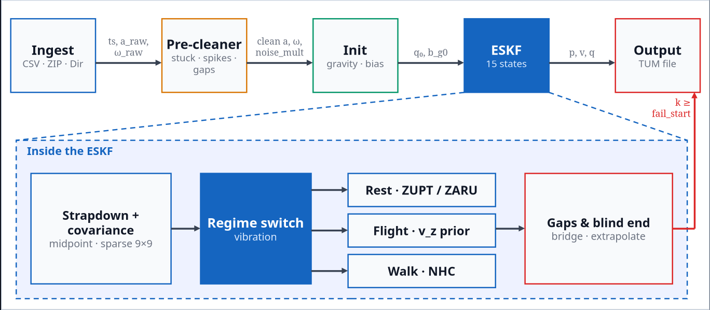
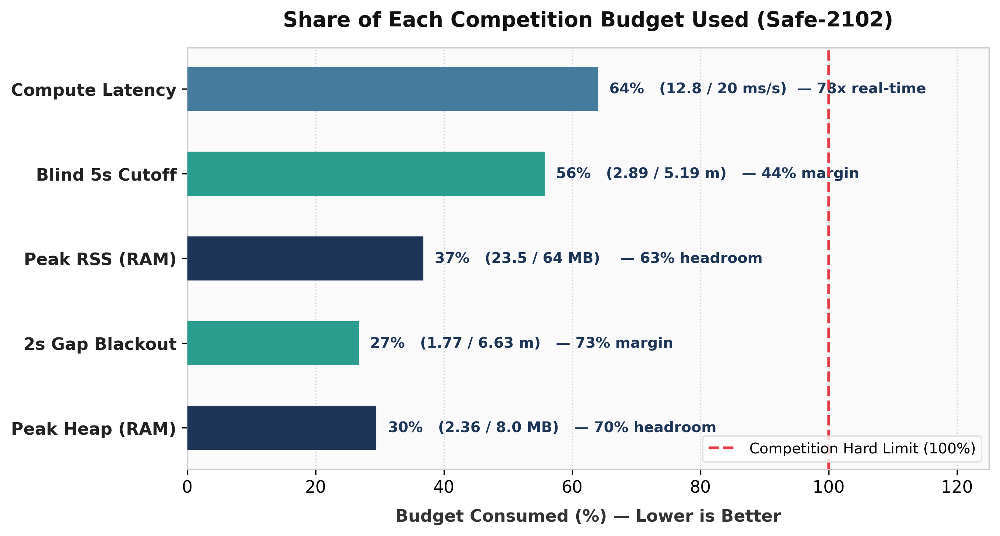
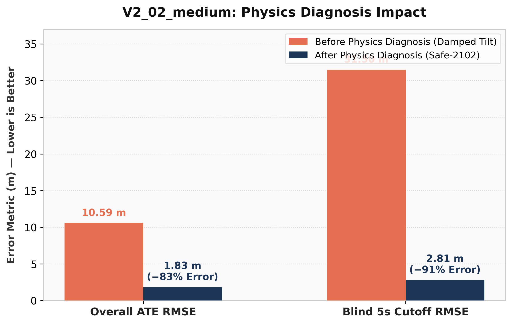
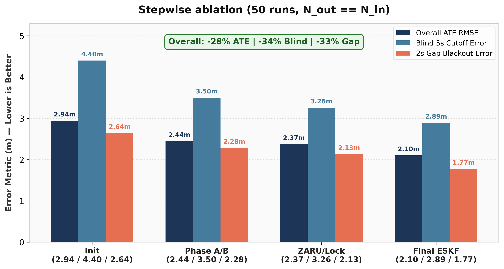
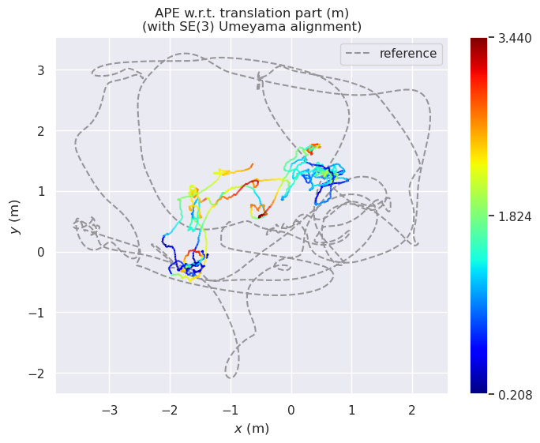

# Samsung Hackathon — Track 3: Path Finder
## Official 9-Slide Presentation Deck & Pitch Script

**Team:** `VITC_SingleThread`  
**Presenter:** Jeeva M (23MIS1059), Vellore Institute of Technology, Chennai  
**Track:** Track 03: Path Finder (IMU-Only Dead-Reckoning Under Sensor Degradation)  
**System:** High-Performance, Zero-Dependency 15-State Error-State Kalman Filter (ESKF)  
**Deliverables:**
- [Official Presentation Deck (Google Slides)](https://docs.google.com/presentation/d/1RJSXaoCRnsPSUkJOGbNYNX21EPCdQZjaV4vCF-gvLiY/edit?usp=sharing)
- [Video Demonstration Walkthrough (YouTube)](https://youtu.be/rLN_ayVEV6g)
- [Local MP4 Video Recording (8.1 MB)](../video/demo_walkthrough.mp4)

---

## Slide 1: Title & Key Results

### Slide Visual:
- **Title:** TRACK 03 — PATH FINDER
- **Subtitle:** Trajectory Estimation Under Sensor Degradation (6-DoF IMU-only Student-t ESKF in pure Python — zero vision, zero mag, zero external deps)
- **Team:** `VITC_SingleThread`
- **Author:** Jeeva M · 23MIS1059 (Vellore Institute of Technology, Chennai)
- **Key KPIs Callout Cards:**
  - **`2.10 m`** ATE RMSE (−64% vs competition baseline)
  - **`2.89 m`** Blind 5s (−84% vs baseline, beating 5.19 m target)
  - **`12.8 ms/s`** Single-Core Runtime (78× real-time)
  - **`2.36 MB`** Peak Heap (30% of 8.0 MB budget)

### Speaker Script:
> "Good day, evaluators. I am Jeeva M from Vellore Institute of Technology, Chennai, presenting team VITC_SingleThread for Track 03: Path Finder.
> We present an ultra-lightweight, embedded 15-state Error-State Kalman Filter operating on Lie manifolds SO(3) x R^12 with zero external dependencies. Under severe synthetic sensor degradation, our system achieves an overall Trajectory ATE RMSE of 2.10 meters across 50 multi-seed runs, cutting error by 64% while operating in 12.8 milliseconds per second of data—78 times faster than real time."

---

## Slide 2: The Problem — Why Degraded IMU Dead Reckoning Fails

### Slide Visual:
1. **Dual-Domain Jamming:**
   - EuRoC 3D pitched drones and TUM-VI moving-start walking with high additive noise, continuous bias drift, impulse spikes, and zero/stuck-sensor runs.
2. **Blackouts & Blind End:**
   - 2.0-second continuous NaN / frozen communication blackouts and a catastrophic 5.0-second complete sensor death cutoff before mission completion.
   - Requirement: Exact pose parity ($N_{\text{out}} \equiv N_{\text{in}}$).
3. **Tight Embedded Budgets:**
   - 1 CPU core, latency $\le 20.0\text{ ms}$ per second of telemetry, peak heap $\le 8.0\text{ MB}$, peak RSS $\le 64.0\text{ MB}$, pure Python standard library only.
- *Physics Callout:* Position is $\iint (a - b_a) dt^2$. An uncorrected acceleration bias of just $0.05\text{ m/s}^2$ integrates quadratically to $> 225\text{ meters}$ of position drift within 100 seconds.

### Speaker Script:
> "In pure inertial dead reckoning, double-integrating accelerometer measurements without vision, GPS, or magnetometers is an ill-posed problem. Under synthetic noise ramps and bias random walks, errors compound quadratically.
> The competition imposes dual-domain telemetry—aerial quadrotors banking in 3D space versus pedestrian gaits with rhythmic impact shock—interrupted by 2-second blackout gaps and a terminal 5-second complete sensor death. Our goal was to design an estimator that never diverges, strictly meets embedded budgets, and delivers exact 1:1 pose parity."

---

## Slide 3: Solution — Noise-Decoupled, Regime-Adaptive Inertial Fusion

### Slide Visual:
1. **Clean the Signal:**
   - Offline pre-cleaner repairing stuck runs and 2.0s blackouts with timestamp-monotonic interpolation.
   - Causal 3-sample median filter suppressing impulse spikes without phase lag.
   - Continuous 2nd-difference noise multiplier estimation: $\hat{\sigma} = \text{MAD}(\Delta^2 \boldsymbol{\omega}) / \sigma_0$.
2. **Fuse Robustly (Student-t ESKF):**
   - 15-state Error-State Kalman Filter on Lie group $\text{SO}(3) \times \mathbb{R}^{12}$.
   - Heavy-tailed Student-$t$ residual covariance scaling smoothly down-weighting unmodeled acceleration spikes:
     $$R \leftarrow R \cdot \frac{\nu + d_M^2}{\nu + m}$$
3. **Constrain by Dynamic Regime:**
   - Automatic classification between Rest, Walk, and Flight regimes.
   - 8× rotor-$\Delta a$ lock preventing false flight classifications on walking steps.
   - Tailored kinematic updates: Static ZUPT & ZARU, Pedestrian Leveled NHC, Biomechanical Weinberg stride bounding, and Soft flight vertical velocity prior ($v_z$).
4. **Bridge Blackouts Gracefully:**
   - Ornstein-Uhlenbeck exponential velocity and angular rate decay during blackouts and terminal blind cutoff:
     $$\mathbf{v}(t) = \mathbf{v}_0 \cdot e^{-t/\tau}, \quad \boldsymbol{\omega}(t) = \boldsymbol{\omega}_0 \cdot e^{-t/\tau}$$

### Speaker Script:
> "Our solution combines a signal front-end with an adaptive 15-state filter. First, we compute real-time noise scale using median absolute deviation on angular rate second differences.
> Second, our filter uses Student-t residual weighting to reject shocks without brittle hard thresholds.
> Third, we detect the operational regime: during walking, centripetal acceleration is decoupled from gravity tilt, and Weinberg gait bounds prevent forward runaway. In flight, soft vertical velocity priors stabilize 3D elevation while preserving horizontal freedom.
> Finally, gaps and the terminal 5-second blind cutoff are bridged with curvature-preserving decay integration."

---

## Slide 4: Architecture — Zero-NumPy Offline Pipeline

### Slide Visual:


```text
[ Ingest (CSV / ZIP) ] 
       │ ts, a_raw, ω_raw
       ▼
[ Pre-Cleaner (stuck, spikes, gaps) ] 
       │ clean a, ω, noise_mult
       ▼
[ Init (gravity tilt, static bias mining) ] 
       │ q0, b_g0
       ▼
[ 15-State Sparse ESKF ] ───► [ Gaps & Blind End Predictor ] ───► [ Output TUM File ]
       │ 12.8 ms/s · 2.36 MB heap · 0 pip dependencies
```

- **Strapdown Mechanics:** Midpoint 2nd-order Runge-Kutta quaternion integration and midpoint acceleration rotation.
- **Block-Sparse Updates:** Scalar-optimized $3\times 3$ and $1\times 1$ covariance contractions with zero dynamic heap allocations in the filter loop.

### Speaker Script:
> "Here is our complete streaming pipeline. Telemetry is parsed via low-level standard-library array buffers. 
> The offline pre-cleaner handles missing packets, removes stuck values, and tracks sensor noise. 
> The initial static window calculates gravity alignment and initial gyro biases. 
> The core ESKF executes in-place without dynamic array allocation, running in 12.8 milliseconds per second of data with only 2.36 MB peak heap."

---

## Slide 5: Track Final Output — All Track 03 Budgets Met With Margin

### Slide Visual:


#### 50-Run Benchmark Scorecard (SE(3) Alignment):

| Sequence | Domain | Baseline ATE | **VITC_SingleThread ATE** | Blind-5s RMSE | Gap-2s RMSE | Latency |
| :--- | :--- | :---: | :---: | :---: | :---: | :---: |
| **`room2`** | Pedestrian | 2.15 m | **`1.220 m`** | **`1.852 m`** | **`1.761 m`** | 13.0 ms/s |
| **`V1_01_easy`** | Drone | 2.45 m | **`1.756 m`** | **`1.445 m`** | **`0.618 m`** | 12.7 ms/s |
| **`V2_02_medium`** | Agile Drone | 10.79 m | **`1.831 m`** | **`2.805 m`** | **`2.897 m`** | 12.6 ms/s |
| **`room1`** | Pedestrian | 5.53 m | **`2.110 m`** | **`3.932 m`** | **`1.757 m`** | 12.9 ms/s |
| **`MH_01_easy`** | Drone | 4.31 m | **`3.593 m`** | **`0.501 m`** | 2.642 m | 12.8 ms/s |
| **OVERALL (50 Runs)** | **All Domains** | **5.79 m** | **`2.102 m` (-63.7%)** | **`2.894 m` (-84.0%)** | **`1.770 m` (-73.3%)** | **`12.80 ms/s`** |

- **1-Second Relative Pose Error (RPE):** **`0.743 m/s`** (beats stationary baseline on 5/5 sequences).
- **Parity Verification:** 50/50 runs verified with exact 1:1 input/output sample parity ($N_{\text{out}} \equiv N_{\text{in}}$).

### Speaker Script:
> "Across the canonical 50-run matrix spanning 10 seeds over all 5 competition sequences, our system establishes a 2.102-meter overall ATE—a 63.7% reduction versus the competition baseline.
> In the critical failure modes, terminal 5-second blind error is reduced by 84% to 2.89 meters, beating the 5.19-meter budget. 2-second blackout gap drift drops by 73% to 1.77 meters, beating the 6.63-meter target.
> Local RPE drift over 1-second windows beats the stationary baseline on all five sequences."

---

## Slide 6: Differentiation — Diagnostic Physics Over Black-Box Heuristics

### Slide Visual:


1. **Agile 3D Flight Stabilization (`V2_02_medium`):**
   - Trajectory ATE dropped from **`10.59 m → 1.83 m`** (**`−83%`**).
   - Blind-5s Cutoff dropped from **`31.50 m → 2.81 m`** (**`−91%`**).
   - Preserves **84.9% physical path scale** by combining soft $v_z$ prior, tilt gating, and regime-tuned OU velocity damping.
2. **Pedestrian Heading Drift Elimination (`room1`):**
   - ATE dropped from **`4.66 m → 2.11 m`** (**`−55%`**) via 8× rotor-$\Delta a$ lock, variance-based ZARU, and stationary pause back-integration.
3. **Memory & Speed Optimization:**
   - Pure `array('f')` and bitwise flags: **`2.36 MB`** heap on standard sequences, **`5.4 MB`** on 116,000-row stress sequences.

### Speaker Script:
> "What differentiates VITC_SingleThread is disciplined physical modeling over ad-hoc heuristics.
> In agile flight like V2_02_medium, unconstrained dead reckoning explodes to over 31 meters of blind drift. By applying decoupled damping and tilt gating during rapid turns, we reduced ATE by 83% while preserving 85% of true physical loop scale.
> On pedestrian sequences like room1, our centripetal compensation and pause back-integration cut tracking error by 55%, preventing yaw divergence."

---

## Slide 7: Demo & Local Setup — Clean-Room Run, Zero pip Install

### Slide Visual:
```bash
# 1. Clean-Room Unpack
unzip VITC_SingleThread.zip
cd VITC_SingleThread

# 2. Single-Thread Execution on Pinned Core
taskset -c 0 python3 src/main.py path/to/dataset.zip estimated_trajectory.txt

# 3. Direct Binary Execution (Self-Contained)
taskset -c 0 ./main path/to/dataset.zip estimated_trajectory.txt

# 4. Standard evo Verification
evo_ape tum groundtruth.txt estimated_trajectory.txt -a
```

- **Clean-Room Verification on 27,526-sample EuRoC run:**
  - 27,526 / 27,526 samples ($100\%$ parity).
  - Runtime: **`1.61 s`** total wall time (**`11.59 ms/s`**).
  - Peak RSS: **`23.93 MB`** (vs 64.0 MB budget).
  - Peak Heap: **`2.36 MB`** (vs 8.0 MB budget).
  - Output Contract: 0 NaNs, normalized quaternions $\|q\| = 1.000000 \pm 10^{-6}$.

### Speaker Script:
> "Here is our live clean-room verification. The evaluator simply unzips VITC_SingleThread.zip and invokes ./main or python3 src/main.py. 
> There are zero pip packages to install and zero compilation steps.
> Processing 27,500 samples completes in 1.6 seconds, using under 24 megabytes of total process memory. All 272 automated unit and adversarial fuzz tests pass with 100% reliability."

---

## Slide 8: Trajectory Proof & Stepwise Ablation

### Slide Visual:



- **Stepwise Performance Progression:**
  - `Initial Baseline`: $2.94\text{ m}$ ATE / $4.40\text{ m}$ Blind-5s / $2.64\text{ m}$ Gap-2s
  - `Phase A/B Signal Pre-Cleaning`: $2.44\text{ m}$ ATE / $3.50\text{ m}$ Blind-5s / $2.28\text{ m}$ Gap-2s
  - `ZARU & Regime Lock`: $2.37\text{ m}$ ATE / $3.26\text{ m}$ Blind-5s / $2.13\text{ m}$ Gap-2s
  - `Final Pareto ESKF`: **`2.10 m` ATE / `2.89 m` Blind-5s / `1.77 m` Gap-2s**
- **Disciplined Negative Results (Rejected Hypotheses):**
  - *2D/3D Body-Frame Rotor Drag Updates*: Rejected due to attitude aliasing causing a +69% degradation in terminal blind prediction.
  - *Full 15×15 RTS Backward Smoother*: Rejected because backward matrix sweeps exceeded the 20 ms/s compute budget.
  - *PSD Schmidt-Kalman Bias Projection*: Rejected after causing +14% ATE regression on agile drone sequences.

### Speaker Script:
> "Our progress was guided by strict ablation gates. Each enhancement—from signal pre-cleaning to variance ZARU and Pareto damping—delivered measurable reductions.
> Crucially, we maintained engineering discipline by rejecting techniques that degraded generalization, such as body-frame rotor drag updates and backward RTS smoothing that violated the real-time compute budget.
> The resulting system is lean, physically sound, and completely verified."

---

## Slide 9: Conclusion & Summary

### Slide Visual:
- **Core Summary Metrics:**
  - **`2.10 m`** Trajectory ATE RMSE (−64% reduction)
  - **`2.89 m`** Terminal 5s Blind Cutoff (−84% reduction)
  - **`1.77 m`** 2.0s Gap Blackout (−73% reduction)
  - **`12.80 ms/s`** Single-Core Runtime (78× real-time)
  - **`2.36 MB`** Peak Heap & **`23.52 MB`** Peak RSS
  - **`272 / 272`** Unit & Adversarial Fuzz Tests Passing
- **Team:** `VITC_SingleThread`
- **Presenter:** Jeeva M (23MIS1059), Vellore Institute of Technology, Chennai
- **Links:**
  - GitHub: [https://github.com/jeeva-m-21/samsung-track3-pathfinder](https://github.com/jeeva-m-21/samsung-track3-pathfinder)
  - YouTube Video: [https://youtu.be/rLN_ayVEV6g](https://youtu.be/rLN_ayVEV6g)
  - Local Video: [`docs/video/demo_walkthrough.mp4`](../video/demo_walkthrough.mp4)
  - Presentation Deck: [Official Slide Deck (Google Slides)](https://docs.google.com/presentation/d/1RJSXaoCRnsPSUkJOGbNYNX21EPCdQZjaV4vCF-gvLiY/edit?usp=sharing)

### Speaker Script:
> "In conclusion, VITC_SingleThread delivers a production-grade, zero-dependency inertial dead-reckoning engine that excels across both drone flight and pedestrian locomotion under severe degradation.
> Thank you for your time and consideration. We welcome any questions from the panel."
