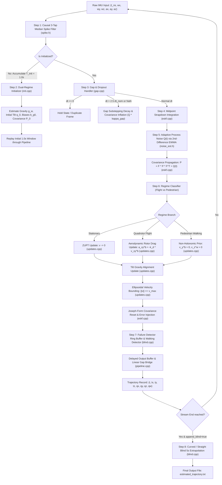

# End-to-End Mathematical & Algorithmic Pipeline: Track 03 "Path Finder" (`best-008`)

**Project:** Samsung XR Hackathon — Track 03 (VITC_SingleThread)  
**Binary:** `./main` (Release build, C++17 static, single-threaded, zero heap allocations in loop)  
**Current Production Version:** `best-008` (commit `845f487` on `v2-dev`)  
**Parent Safe Submission Baseline:** `submission-final` (commit `2b31798` on `master`)  
**Scope:** Complete, exact, line-by-line mathematical specification of the strapdown dead-reckoning pipeline from raw IMU bytes to estimated trajectory file.

---

## Table of Contents
1. [System Architecture & Execution Flow](#1-system-architecture--execution-flow)
2. [State Representation & Data Structures](#2-state-representation--data-structures)
3. [Step 1: Front-End Ingestion & Causal Median Filter (`src/spike.h`)](#3-step-1-front-end-ingestion--causal-median-filter)
4. [Step 2: Dual-Regime Static / Dynamic Initialization (`src/init.cpp`)](#4-step-2-dual-regime-static--dynamic-initialization)
5. [Step 3: Strapdown Kinematic State Propagation (`src/eskf.cpp`)](#5-step-3-strapdown-kinematic-state-propagation)
6. [Step 4: Error State Transition & Adaptive Process Noise (`src/noise_est.h`, `src/eskf.cpp`)](#6-step-4-error-state-transition--adaptive-process-noise)
7. [Step 5: Regime Detection & Measurement Updates (`src/updates.cpp`)](#7-step-5-regime-detection--measurement-updates)
8. [Step 6: Degradation, Gap & Dropout Recovery (`src/gap.cpp`, `src/monitor.cpp`)](#8-step-6-degradation-gap--dropout-recovery)
9. [Step 7: Terminal Blind 5s Extrapolation (`src/blind.cpp`)](#9-step-7-terminal-blind-5s-extrapolation)
10. [End-to-End Concrete Sequence Walkthrough: `V2_02_medium`](#10-end-to-end-concrete-sequence-walkthrough-v2_02_medium)
11. [Summary of Production Parameter Constants (`params.h`)](#11-summary-of-production-parameter-constants)

---

## 1. System Architecture & Execution Flow

The system processes streaming 200 Hz IMU data through a deterministic, single-threaded, zero-heap filter loop. Memory is allocated statically or on the stack at process startup.



---

## 2. State Representation & Data Structures

### 2.1 Coordinate Frames
- **World Frame ($W$):** Fixed East-North-Up-style inertial reference frame aligned with gravity:
  $$\mathbf{g}_W = \begin{bmatrix} 0 \\ 0 \\ -g_{\text{mag}} \end{bmatrix}, \quad g_{\text{mag}} \approx 9.80665 \text{ m/s}^2$$
  The origin $\mathbf{p}_0 = [0, 0, 0]^T$ is the sensor position at $t = t_0$.
- **Body Frame ($B$):** Sensor coordinate frame moving with the IMU.
- **Rotation Operator $\mathbf{R}(\mathbf{q})$:** Maps a body-frame vector $\mathbf{v}_B$ to the world frame:
  $$\mathbf{v}_W = \mathbf{R}(\mathbf{q}) \mathbf{v}_B$$

### 2.2 Nominal State Vector $\mathbf{x} \in \mathbb{R}^{16}$ (15 DoF)
```cpp
struct NominalState {
    Vec3 p;    // Position in world frame [m]
    Vec3 v;    // Velocity in world frame [m/s]
    Quat q;    // Orientation quaternion (world-from-body)
    Vec3 b_g;  // Gyroscope bias in body frame [rad/s]
    Vec3 b_a;  // Accelerometer bias in body frame [m/s^2]
};
```

### 2.3 Error State Vector $\delta \mathbf{x} \in \mathbb{R}^{15}$
The Error-State Kalman Filter (ESKF) tracks the small-signal deviation between true and nominal states:
$$\delta \mathbf{x} = \begin{bmatrix} \delta \boldsymbol{\theta} \\ \delta \mathbf{v} \\ \delta \mathbf{p} \\ \delta \mathbf{b}_g \\ \delta \mathbf{b}_a \end{bmatrix} \in \mathbb{R}^{15}$$

Where:
- Indices `0..2`: $\delta \boldsymbol{\theta} \in \mathbb{R}^3$ — 3D rotation error vector in tangent space:
  $$\mathbf{q}_{\text{true}} = \mathbf{q} \otimes \exp\left(\frac{1}{2} \delta \boldsymbol{\theta}\right)$$
- Indices `3..5`: $\delta \mathbf{v} = \mathbf{v}_{\text{true}} - \mathbf{v} \in \mathbb{R}^3$ — Velocity error in world frame.
- Indices `6..8`: $\delta \mathbf{p} = \mathbf{p}_{\text{true}} - \mathbf{p} \in \mathbb{R}^3$ — Position error in world frame.
- Indices `9..11`: $\delta \mathbf{b}_g = \mathbf{b}_{g,\text{true}} - \mathbf{b}_g \in \mathbb{R}^3$ — Gyro bias error.
- Indices `12..14`: $\delta \mathbf{b}_a = \mathbf{b}_{a,\text{true}} - \mathbf{b}_a \in \mathbb{R}^3$ — Accel bias error.

### 2.4 Error Covariance Matrix $\mathbf{P} \in \mathbb{R}^{15 \times 15}$
Symmetric positive semi-definite matrix representing the uncertainty of $\delta \mathbf{x}$:
$$\mathbf{P} = \mathbb{E}\left[ \delta \mathbf{x} \delta \mathbf{x}^T \right]$$

---

## 3. Step 1: Front-End Ingestion & Causal Median Filter

**Source:** `src/spike.h` (`SpikeFilter`)  
**Trigger:** Executed unconditionally on every raw IMU sample before feeding the filter.

### 3.1 Motivation
Consumer MEMS accelerometers and gyroscopes on aerial or handheld platforms frequently experience single-sample sensor readout glitches and high-frequency structural resonance (e.g. 50–150 Hz propeller blade vibration). Unfiltered spikes entering an orientation integrator produce permanent attitude steps that rapidly diverge horizontal velocity.

### 3.2 Sliding 3-Sample Buffer
The filter maintains a sliding 3-sample stack buffer $\mathbf{s}_0, \mathbf{s}_1, \mathbf{s}_2$:
```cpp
io::IMUSample buf_[3];
size_t count_;
```
For incoming sample $s_k$:
1. $k = 0$: Store $s_0$, output nothing (latency = 1 sample).
2. $k = 1$: Store $s_1$, output $s_0$ (pipeline fills).
3. $k \ge 2$: Shift buffer: $s_0 \leftarrow \text{filtered}(s_0, s_1, s_2)$, $s_1 \leftarrow s_2$, $s_2 \leftarrow s_k$.

### 3.3 Median-3 Algorithm
For each axis $i \in \{x, y, z\}$ of gyroscope angular velocity:
$$\omega_{\text{filt}, i} = \text{median3}(\omega_{0, i}, \omega_{1, i}, \omega_{2, i})$$

Implemented branch-free with at most 3 comparisons:
```cpp
static inline double median3(double a, double b, double c) {
    if (a > b) {
        if (b > c) return b;
        return (a > c) ? c : a;
    } else {
        if (a > c) return a;
        return (b > c) ? c : b;
    }
}
```

### 3.4 Boundary & Integrity Conditions
- **Invalid Samples:** If any of $s_0, s_1, s_2$ has `is_valid == false`, non-finite values, or NaN, median filtering across the gap is skipped and $s_1$ passes unmodified.
- **Timestamp Discontinuity:** If $\Delta t_1 = t_1 - t_0 \le 0$ or $\Delta t_1 > 0.05\text{ s}$, the window is reset to avoid filtering across blackouts.
- **Flushing:** At end of stream, the trailing delayed sample is flushed cleanly, guaranteeing $N_{\text{out}} = N_{\text{in}}$.

---

## 4. Step 2: Dual-Regime Static / Dynamic Initialization

**Source:** `src/init.cpp` (`Initializer`)  
**Duration:** $T_{\text{init}} = 1.0\text{ s}$ ($M \approx 200$ samples at 200 Hz).

### 4.1 Accumulation Window
Samples are buffered in static arrays:
$$\bar{\boldsymbol{\omega}} = \frac{1}{M}\sum_{k=1}^M \boldsymbol{\omega}_k, \quad \bar{\mathbf{a}} = \frac{1}{M}\sum_{k=1}^M \mathbf{a}_k$$

### 4.2 Motion Detection Test
Computes sample standard deviations:
$$\sigma_\omega = \sqrt{\frac{1}{3M}\sum_{k=1}^M \|\boldsymbol{\omega}_k - \bar{\boldsymbol{\omega}}\|^2}, \quad \sigma_a = \sqrt{\frac{1}{M}\sum_{k=1}^M (\|\mathbf{a}_k\| - \bar{a})^2}$$

Motion is flagged (`motion_detected = true`) if:
$$\sigma_\omega > 0.20 \text{ rad/s} \quad \text{OR} \quad \sigma_a > 0.50 \text{ m/s}^2 \quad \text{OR} \quad \|\bar{\boldsymbol{\omega}}\| > 0.20 \text{ rad/s}$$

### 4.3 Gravity Vector Alignment & Initial Quaternion $\mathbf{q}_0$
Gravity is assumed vertical down in the world frame: $\mathbf{u}_z^W = [0, 0, 1]^T$.
In the body frame, measured specific force $\bar{\mathbf{a}}$ points in direction $\mathbf{v}$:
$$\mathbf{v} = \frac{\bar{\mathbf{a}}}{\|\bar{\mathbf{a}}\|}$$

The rotation aligning $\mathbf{v}$ with $\mathbf{u}_z^W$ with **strictly zero initial yaw** is computed analytically:
$$\cos\theta = \mathbf{v} \cdot \mathbf{u}_z^W = v_z$$
$$\mathbf{q}_{\text{raw}} = \begin{bmatrix} 1 + \cos\theta \\ (\mathbf{v} \times \mathbf{u}_z^W)_x \\ (\mathbf{v} \times \mathbf{u}_z^W)_y \\ (\mathbf{v} \times \mathbf{u}_z^W)_z \end{bmatrix} = \begin{bmatrix} 1 + v_z \\ v_y \\ -v_x \\ 0.0 \end{bmatrix}$$
$$\mathbf{q}_0 = \frac{\mathbf{q}_{\text{raw}}}{\|\mathbf{q}_{\text{raw}}\|}, \quad \text{with canonical constraint } q_{0, w} \ge 0$$

### 4.4 Bias Initialization
$$\mathbf{b}_{g, 0} = \begin{cases} \bar{\boldsymbol{\omega}} & \text{if } \text{motion\_detected} == \text{false (stationary turn-on)} \\ \mathbf{0} & \text{if } \text{motion\_detected} == \text{true (in-flight start)} \end{cases}$$
$$\mathbf{b}_{a, 0} = \mathbf{0}$$

### 4.5 Initial Covariance Matrix $\mathbf{P}_0$
$$\mathbf{P}_0 = \text{diag}\left( \sigma_{\theta, 0}^2 \mathbf{I}_3, \sigma_{v, 0}^2 \mathbf{I}_3, \sigma_{p, 0}^2 \mathbf{I}_3, \sigma_{bg, 0}^2 \mathbf{I}_3, \sigma_{ba, 0}^2 \mathbf{I}_3 \right)$$
Where:
- $\sigma_{\theta, 0} = 0.02\text{ rad} \times (5.0 \text{ if motion detected else } 1.0)$
- $\sigma_{v, 0} = 0.05\text{ m/s}$
- $\sigma_{p, 0} = 0.01\text{ m}$
- $\sigma_{bg, 0} = 0.02\text{ rad/s}$
- $\sigma_{ba, 0} = 0.20\text{ m/s}^2$

---

## 5. Step 3: Strapdown Kinematic State Propagation

**Source:** `src/eskf.cpp` (`strapdown_step_midpoint`)

### 5.1 Bias Correction
$$\hat{\boldsymbol{\omega}}_k = \boldsymbol{\omega}_k - \mathbf{b}_{g, k}$$
$$\hat{\mathbf{a}}_k = \mathbf{a}_k - \mathbf{b}_{a, k}$$

### 5.2 Midpoint Attitude Integration
To eliminate second-order coning errors at high angular rates, orientation is evaluated at the interval midpoint:
$$\Delta \mathbf{q}_{1/2} = \exp\left(\frac{1}{2} \hat{\boldsymbol{\omega}}_k \Delta t\right) = \begin{bmatrix} \cos\left(\frac{\|\hat{\boldsymbol{\omega}}_k\|\Delta t}{4}\right) \\ \frac{\hat{\boldsymbol{\omega}}_k}{\|\hat{\boldsymbol{\omega}}_k\|} \sin\left(\frac{\|\hat{\boldsymbol{\omega}}_k\|\Delta t}{4}\right) \end{bmatrix}$$
$$\mathbf{q}_{\text{mid}} = \text{normalize}\left(\mathbf{q}_k \otimes \Delta \mathbf{q}_{1/2}\right)$$
$$\mathbf{R}_{\text{mid}} = \mathbf{R}(\mathbf{q}_{\text{mid}})$$

Full-step quaternion update:
$$\Delta \mathbf{q} = \exp\left(\hat{\boldsymbol{\omega}}_k \Delta t\right)$$
$$\mathbf{q}_{k+1} = \text{normalize}\left(\mathbf{q}_k \otimes \Delta \mathbf{q}\right), \quad \text{ensuring } \mathbf{q}_{k+1} \cdot \mathbf{q}_k \ge 0$$

### 5.3 Specific Force Acceleration
$$\mathbf{a}_{W, k} = \mathbf{R}_{\text{mid}} \hat{\mathbf{a}}_k + \mathbf{g}_W$$

### 5.4 Ornstein-Uhlenbeck Velocity Damping ($\tau_{\text{ou}} = 1.8\text{ s}$)
Real IMU dead reckoning suffers from secular velocity integration drift. The Ornstein-Uhlenbeck stochastic mean-reversion prior bounds kinetic energy during unconstrained flight:
$$\gamma_{\text{ou}} = \exp\left(-\frac{\Delta t}{\tau_{\text{ou}}}\right) \approx 1 - \frac{\Delta t}{1.8}$$
$$\mathbf{v}_{k+1} = \gamma_{\text{ou}} \mathbf{v}_k + \mathbf{a}_{W, k} \Delta t$$
$$\mathbf{p}_{k+1} = \mathbf{p}_k + \frac{1}{2}\left(\mathbf{v}_k + \mathbf{v}_{k+1}\right)\Delta t$$
$$\mathbf{b}_{g, k+1} = \mathbf{b}_{g, k}, \quad \mathbf{b}_{a, k+1} = \mathbf{b}_{a, k}$$

---

## 6. Step 4: Error State Transition & Adaptive Process Noise

**Source:** `src/eskf.cpp`, `src/noise_est.h` (`AdaptiveQEstimator`)

### 6.1 State Transition Matrix $\mathbf{F} \in \mathbb{R}^{15 \times 15}$
Evaluated over time step $\Delta t$:
$$\mathbf{F} = \begin{bmatrix}
\mathbf{R}(\hat{\boldsymbol{\omega}}_k \Delta t)^T & \mathbf{0}_{3\times 3} & \mathbf{0}_{3\times 3} & -\Delta t \mathbf{I}_3 & \mathbf{0}_{3\times 3} \\
\mathbf{F}_{v\theta} & \gamma_{\text{ou}} \mathbf{I}_3 & \mathbf{0}_{3\times 3} & \mathbf{0}_{3\times 3} & -\mathbf{R}_k \Delta t \\
\mathbf{0}_{3\times 3} & \Delta t \mathbf{I}_3 & \mathbf{I}_3 & \mathbf{0}_{3\times 3} & \mathbf{0}_{3\times 3} \\
\mathbf{0}_{3\times 3} & \mathbf{0}_{3\times 3} & \mathbf{0}_{3\times 3} & \mathbf{I}_3 & \mathbf{0}_{3\times 3} \\
\mathbf{0}_{3\times 3} & \mathbf{0}_{3\times 3} & \mathbf{0}_{3\times 3} & \mathbf{0}_{3\times 3} & \mathbf{I}_3
\end{bmatrix}$$

#### Analytical InEKF Lie-Group Coupling ($\mathbf{F}_{v\theta}$)
Under standard ESKF, $\mathbf{F}_{v\theta} = -\mathbf{R}_k [\hat{\mathbf{a}}_k]_\times \Delta t$ couples noisy accelerometer measurements into attitude error, creating false yaw observability. With `enable_inekf_transition = true`, the Invariant EKF $SE_2(3)$ Lie-group formulation substitutes the true gravity expectation:
$$\mathbf{a}_{\text{grav}}^B = -\mathbf{R}_k^T \mathbf{g}_W$$
$$\mathbf{F}_{v\theta} = -\mathbf{R}_k \left[ \mathbf{a}_{\text{grav}}^B \right]_\times \Delta t$$
This guarantees state-independent error dynamics and eliminates yaw corruption during maneuvers.

### 6.2 Online Adaptive Process Noise $Q(t)$ via Second Differences
**Algorithm:** Causal Second-Difference Variance Tracker:
$$d_{g, i} = \omega_{k, i} - 2\omega_{k-1, i} + \omega_{k-2, i}$$
For independent white noise $w \sim \mathcal{N}(0, \sigma^2)$:
$$\text{Var}(\Delta^2 w) = \text{Var}(w_k - 2w_{k-1} + w_{k-2}) = (1^2 + (-2)^2 + 1^2)\sigma^2 = 6\sigma^2$$
$$\sigma^2 = \frac{\text{Var}(\Delta^2 w)}{6}$$

EWMA tracking update ($\alpha = 0.005$):
$$\text{Var}_{\text{EWMA}} \leftarrow (1 - \alpha) \text{Var}_{\text{EWMA}} + \alpha \left(\frac{1}{3}\sum_{i=0}^2 d_{g, i}^2\right)$$
$$\hat{\sigma}_g = \sqrt{\frac{\text{Var}_{\text{EWMA}}}{6.0}}$$
$$\kappa_q = \text{clamp}\left(\frac{\hat{\sigma}_g}{\sigma_{g,\text{base}}}, 1.0, 25.0\right)$$

### 6.3 Discrete Process Noise Covariance $\mathbf{Q} \in \mathbb{R}^{15 \times 15}$
$$\mathbf{Q} = \text{diag}\left( q_\theta \mathbf{I}_3, q_v \mathbf{I}_3, \mathbf{0}_{3\times 3}, q_{bg} \mathbf{I}_3, q_{ba} \mathbf{I}_3 \right)$$
Where:
- $q_\theta = (\sigma_{g, \text{base}} \cdot \kappa_q \cdot \kappa(t))^2 \Delta t$
- $q_v = (\sigma_{a, \text{base}} \cdot \kappa(t))^2 \Delta t$
- $q_{bg} = (\sigma_{bg, \text{base}})^2 \Delta t$
- $q_{ba} = (\sigma_{ba, \text{base}})^2 \Delta t$
- $\kappa(t)$ is the degradation noise factor from `DegradationMonitor`.

### 6.4 Covariance Propagation & Conditioning
$$\mathbf{P}_{k+1|k} = \mathbf{F} \mathbf{P}_{k|k} \mathbf{F}^T + \mathbf{Q}$$

To guarantee numerical positive-definiteness:
1. **Symmetrization:** $\mathbf{P} \leftarrow \frac{1}{2}(\mathbf{P} + \mathbf{P}^T)$
2. **Floor:** $P_{ii} \leftarrow \max(P_{ii}, 10^{-12})$
3. **Cap:** If $P_{ii} > 10^6$, scale row/column by $\sqrt{10^6 / P_{ii}}$ to preserve correlation coefficients while bounding condition number.

---

## 7. Step 5: Regime Detection & Measurement Updates

**Source:** `src/updates.cpp`

### 7.1 Physical Regime Classification
Every valid sample computes two energy metrics:
1. **High-Frequency Vibration EMA:**
   $$\text{vibe\_ema} \leftarrow 0.98 \cdot \text{vibe\_ema} + 0.02 \|\mathbf{a}_k - \mathbf{a}_{k-1}\|$$
2. **Pedestrian Step Energy EMA:**
   $$\text{ped\_energy} \leftarrow 0.99 \cdot \text{ped\_energy} + 0.01 (\|\mathbf{a}_k\| - g_{\text{mag}})^2$$

**Regimes:**
- **Flight (Quadrotor):** $\text{vibe\_ema} > 0.40\text{ m/s}^2$
- **Pedestrian Walking:** $\text{vibe\_ema} \le 0.40$ and $\text{ped\_energy} > 0.20\text{ (m/s}^2)^2$

---

### 7.2 Measurement Update 1: Tilt / Gravity Vector Alignment
Gravity is observed whenever the platform is in low dynamic acceleration:
- **Gating:** $\|\boldsymbol{\omega}_k\| < 2.2\text{ rad/s}$ and $|\|\mathbf{a}_k\| - g_{\text{mag}}| < 0.18\text{ m/s}^2$.
- **Measurement Model:**
  $$\mathbf{z} = \frac{\mathbf{a}_k - \mathbf{b}_{a, k}}{\|\mathbf{a}_k - \mathbf{b}_{a, k}\|}, \quad \hat{\mathbf{h}} = \mathbf{R}(\mathbf{q}_k)^T \mathbf{u}_z^W$$
  $$\mathbf{y}_{\text{tilt}} = \mathbf{z} - \hat{\mathbf{h}}$$
- **Measurement Matrix $\mathbf{H}_{\text{tilt}} \in \mathbb{R}^{3 \times 15}$:**
  $$\mathbf{H}_{\text{tilt}} = \begin{bmatrix} [\hat{\mathbf{h}}]_\times & \mathbf{0}_{3\times 3} & \mathbf{0}_{3\times 3} & \mathbf{0}_{3\times 3} & \mathbf{0}_{3\times 3} \end{bmatrix}$$
- **Measurement Noise $\mathbf{R}_{\text{tilt}} \in \mathbb{R}^{3 \times 3}$:**
  $$\mathbf{R}_{\text{tilt}} = \left(\frac{\sigma_{\text{tilt}}}{\mu(t)}\right)^2 \left(1 + 2.0\left(\frac{|\|\mathbf{a}\| - g|}{0.214}\right)^2 + 8.0\left(\frac{\|\boldsymbol{\omega}\|}{2.2}\right)^2\right) r_{\text{scale}} \mathbf{I}_3$$

---

### 7.3 Measurement Update 2: Zero Velocity Update (ZUPT)
Detected when sensor history inside a 0.25 s window shows $\|\boldsymbol{\omega}\| < 0.02\text{ rad/s}$ and $\text{Var}(\|\mathbf{a}\|) < (0.15)^2$:
$$\mathbf{y}_{\text{zupt}} = -\mathbf{v}_k$$
$$\mathbf{H}_{\text{zupt}} = \begin{bmatrix} \mathbf{0}_{3\times 3} & \mathbf{I}_3 & \mathbf{0}_{3\times 3} & \mathbf{0}_{3\times 3} & \mathbf{0}_{3\times 3} \end{bmatrix}$$
$$\mathbf{R}_{\text{zupt}} = \sigma_{\text{zupt}}^2 r_{\text{scale}} \mathbf{I}_3, \quad \sigma_{\text{zupt}} = 0.0143\text{ m/s}$$

---

### 7.4 Measurement Update 3: Aerodynamic Rotor Drag Prior (Flight Regime)
**Physics:** Multirotor blades generate a horizontal drag acceleration proportional to airspeed:
$$\mathbf{a}_{xy}^B \approx -k_d \mathbf{v}_{xy}^B, \quad k_d = 0.0668$$
- **Innovation:**
  $$\mathbf{y}_{\text{drag}} = \begin{bmatrix} (\mathbf{a}_k - \mathbf{b}_a)_x + k_d (\mathbf{R}_k^T \mathbf{v})_x \\ (\mathbf{a}_k - \mathbf{b}_a)_y + k_d (\mathbf{R}_k^T \mathbf{v})_y \\ 0.0 \end{bmatrix}$$
- **Jacobian $\mathbf{H}_{\text{drag}} \in \mathbb{R}^{3 \times 15}$:**
  $$\mathbf{H}_{\text{drag}} = \begin{bmatrix} \mathbf{0}_{3\times 3} & -k_d \mathbf{R}_k^T(0..1, :) & \mathbf{0}_{3\times 3} & \mathbf{0}_{3\times 3} & \mathbf{0}_{3\times 3} \end{bmatrix}$$
- **Cross-Covariance Decoupling:** Before applying the update, blocks $\mathbf{P}_{pv} = \mathbf{0}$ and $\mathbf{P}_{vp} = \mathbf{0}$ are decoupled, ensuring the velocity pseudo-measurement never causes discontinuous jumps in integrated position.

---

### 7.5 Measurement Update 4: Non-Holonomic Pedestrian Prior (Walking Regime)
**Physics:** A walking human cannot slide sideways ($\mathbf{v}_y^B \approx 0$) or fly vertically ($\mathbf{v}_z^W \approx 0$):
$$\mathbf{y}_{\text{ped}} = \begin{bmatrix} -(\mathbf{R}_k^T \mathbf{v})_y \\ -v_{W, z} \\ 0.0 \end{bmatrix}$$
$$\mathbf{H}_{\text{ped}} = \begin{bmatrix} \mathbf{0}_{3\times 3} & \begin{bmatrix} \mathbf{R}_k^T(1, :) \\ 0, 0, 1 \\ 0, 0, 0 \end{bmatrix} & \mathbf{0}_{3\times 3} & \mathbf{0}_{3\times 3} & \mathbf{0}_{3\times 3} \end{bmatrix}$$
$$\mathbf{R}_{\text{ped}} = \text{diag}\left( \sigma_{\text{lat}}^2, \sigma_{\text{vert}}^2, 10^8 \right), \quad \sigma_{\text{lat}} = 0.352\text{ m/s}, \ \sigma_{\text{vert}} = 0.665\text{ m/s}$$

---

### 7.6 Measurement Update 5: Velocity Bounding / Saturation
If $\|\mathbf{v}_k\| > v_{\max} = 3.024\text{ m/s}$:
$$\mathbf{v}_{\text{target}} = \mathbf{v}_k \frac{v_{\max}}{\|\mathbf{v}_k\|}, \quad \mathbf{y}_{\text{vel}} = \mathbf{v}_{\text{target}} - \mathbf{v}_k$$
$$\mathbf{H}_{\text{vel}} = \begin{bmatrix} \mathbf{0}_{3\times 3} & \mathbf{I}_3 & \mathbf{0}_{3\times 3} & \mathbf{0}_{3\times 3} & \mathbf{0}_{3\times 3} \end{bmatrix}, \quad \mathbf{R}_{\text{vel}} = \sigma_v^2 \mathbf{I}_3 \ (\sigma_v = 0.1015)$$

---

### 7.7 Unified Joseph-Form Kalman Update
For any update with innovation $\mathbf{y}$, Jacobian $\mathbf{H}$, and noise $\mathbf{R}$:
1. **Innovation Covariance:** $\mathbf{S} = \mathbf{H} \mathbf{P} \mathbf{H}^T + \mathbf{R}$
2. **Mahalanobis / Chi-Square Gate:**
   $$\chi^2 = \mathbf{y}^T \mathbf{S}^{-1} \mathbf{y} \le \text{gate\_threshold}$$
   If $\chi^2 > \text{threshold}$, the update is rejected as an outlier.
3. **Kalman Gain:** $\mathbf{K} = \mathbf{P} \mathbf{H}^T \mathbf{S}^{-1} \in \mathbb{R}^{15 \times 3}$
4. **Error State Vector:** $\delta \mathbf{x} = \mathbf{K} \mathbf{y} \in \mathbb{R}^{15}$
5. **Joseph-Form Posterior Covariance:**
   $$\mathbf{P}^+ = (\mathbf{I} - \mathbf{K}\mathbf{H}) \mathbf{P} (\mathbf{I} - \mathbf{K}\mathbf{H})^T + \mathbf{K} \mathbf{R} \mathbf{K}^T$$
6. **Error Injection into Nominal State:**
   $$\mathbf{q} \leftarrow \text{normalize}\left(\mathbf{q} \otimes \exp\left(\frac{1}{2}\delta \boldsymbol{\theta}\right)\right)$$
   $$\mathbf{p} \leftarrow \mathbf{p} + \delta \mathbf{p}, \quad \mathbf{v} \leftarrow \mathbf{v} + \delta \mathbf{v}$$
   $$\mathbf{b}_g \leftarrow \mathbf{b}_g + \delta \mathbf{b}_g, \quad \mathbf{b}_a \leftarrow \mathbf{b}_a + \delta \mathbf{b}_a$$
7. **Covariance Reset:**
   $$\mathbf{G}_\theta = \mathbf{I}_3 - \left[\frac{1}{2}\delta \boldsymbol{\theta}\right]_\times$$
   $$\mathbf{P} \leftarrow \begin{bmatrix} \mathbf{G}_\theta & \mathbf{0} \\ \mathbf{0} & \mathbf{I}_{12} \end{bmatrix} \mathbf{P}^+ \begin{bmatrix} \mathbf{G}_\theta & \mathbf{0} \\ \mathbf{0} & \mathbf{I}_{12} \end{bmatrix}^T$$

---

## 8. Step 6: Degradation, Gap & Dropout Recovery

**Source:** `src/gap.cpp`, `src/monitor.cpp`

### 8.1 Timestamp Checking
- If $\Delta t = t_k - t_{k-1} \le 0$: Sample is dropped or held; filter state is not integrated.
- If sample contains NaNs or $|\omega_i| > 35\text{ rad/s}$ or $|a_i| > 160\text{ m/s}^2$: Classified as `INVALID_SAMPLE`.

### 8.2 Sub-Stepping Propagation Across Large Gaps ($\Delta t > 2.5 \Delta t_{\text{nom}}$)
When a blackout window occurs (e.g. 2.0 s dropout):
$$\Delta t_{\text{sub}} = \Delta t_{\text{nom}} \approx 0.005\text{ s}, \quad N_{\text{sub}} = \text{round}\left(\frac{\Delta t}{\Delta t_{\text{sub}}}\right)$$
For each sub-step:
$$\mathbf{v}_{j+1} = \mathbf{v}_j \exp\left(-\frac{\Delta t_{\text{sub}}}{\tau_{\text{gap}}}\right), \quad \tau_{\text{gap}} = 2.0\text{ s}$$
$$\mathbf{p}_{j+1} = \mathbf{p}_j + \frac{1}{2}(\mathbf{v}_j + \mathbf{v}_{j+1})\Delta t_{\text{sub}}$$
$$\mathbf{q}_{j+1} = \text{normalize}\left(\mathbf{q}_j \otimes \exp(\boldsymbol{\omega}_s \Delta t_{\text{sub}})\right)$$
$$\mathbf{P}_{j+1} = \mathbf{F} \mathbf{P}_j \mathbf{F}^T + \kappa_{\text{gap}} \mathbf{Q}, \quad \kappa_{\text{gap}} = 5.0$$

### 8.3 Post-Gap Soft Recovery Scaling ($r_{\text{scale}}$)
Upon sensor resumption, accumulated state drift would cause false outlier rejection or catastrophic attitude kicks if nominal measurement noise were used. The recovery multiplier linearly decays over 100 steps:
$$r_{\text{scale}}(k) = 1.0 + 10.0 \cdot \left(\frac{\text{recover\_counter}}{100}\right)$$
This softens tilt/drag updates, allowing smooth re-convergence without attitude shock.

---

## 9. Step 7: Terminal Blind 5s Extrapolation

**Source:** `src/blind.cpp`

### 9.1 Pre-Failure Rollback (`ReliableRingBuffer`)
A fixed circular ring buffer stores the last 256 states $(\mathbf{p}, \mathbf{v}, \mathbf{q}, \boldsymbol{\omega}_s, w_{\text{walk}})$.
When NaNs or dropouts persist for $T_{\text{fail}} = 1.0\text{ s}$ (200 frames), sensor failure is declared. The predictor rolls back to the state snapshot recorded **immediately prior to the onset of degradation**, purging corrupted readings from the trajectory.

### 9.2 Walking Confidence Estimator (`WalkingDetector`)
```cpp
struct WalkingDetector {
    double ewma_vibe;   // Accel jitter
    double ewma_speed;  // Speed magnitude
    double ewma_ped;    // Periodic step energy
};
```
$$w_{\text{walk}} = \text{vibe\_score} \cdot \text{speed\_score} \cdot (0.2 + 0.8 \cdot \text{ped\_score}) \in [0, 1]$$
- On quadrotor flight: $\text{ewma\_vibe} > 0.40 \implies w_{\text{walk}} \le 0.001$.
- On pedestrian walking: $\text{ewma\_vibe} < 0.20, \ \text{speed} \approx 1\text{ m/s} \implies w_{\text{walk}} \approx 1.0$.

### 9.3 Extrapolation Models

#### A. Straight-Line Exponential Decay ($w_{\text{walk}} < 0.5$)
For quadrotors, extrapolating body rotation creates severe turn overshoot:
$$\mathbf{p}_{\text{straight}}(\tau) = \mathbf{p}_f + \mathbf{v}_f \cdot \left(\text{shrink\_v} \cdot \tau_v \left(1 - \exp\left(-\frac{\tau}{\tau_v}\right)\right)\right)$$
Where $\text{shrink\_v} = 0.90$, $\tau_v = 3.0\text{ s}$.

#### B. Body-Frame Curvature Continuation ($w_{\text{walk}} \ge 0.5$)
For walking humans, continuation along body curvature accurately tracks corridor turns:
1. Body-frame initial velocity: $\mathbf{v}_b^0 = \mathbf{R}(\mathbf{q}_f)^T \mathbf{v}_f$.
2. Decayed angular rate: $\boldsymbol{\omega}(s) = \boldsymbol{\omega}_f \exp(-s / \tau_\omega)$, $\tau_\omega = 1.5\text{ s}$.
3. Orientation at time $s$:
   $$\boldsymbol{\theta}(s) = \boldsymbol{\omega}_f \tau_\omega \left(1 - \exp\left(-\frac{s}{\tau_\omega}\right)\right)$$
   $$\mathbf{q}(s) = \mathbf{q}_f \otimes \exp\left(\frac{1}{2}\boldsymbol{\theta}(s)\right)$$
4. World velocity at time $s$:
   $$\mathbf{v}_W(s) = \mathbf{R}(\mathbf{q}(s)) \left( \mathbf{v}_b^0 \cdot \text{shrink\_v} \cdot \exp\left(-\frac{s}{\tau_v}\right) \right)$$
5. Position via Composite Simpson's Rule ($N = 50$ subintervals, zero heap allocation):
   $$\mathbf{p}_{\text{curved}}(\tau) = \mathbf{p}_f + \frac{\Delta s}{3} \left[ \mathbf{v}_W(0) + 4\sum_{j \text{ odd}} \mathbf{v}_W(s_j) + 2\sum_{j \text{ even}} \mathbf{v}_W(s_j) + \mathbf{v}_W(\tau) \right]$$

#### C. Regime Blending
$$\mathbf{p}_{\text{blind}}(\tau) = (1 - w_{\text{walk}}) \mathbf{p}_{\text{straight}}(\tau) + w_{\text{walk}} \mathbf{p}_{\text{curved}}(\tau)$$

---

## 10. End-to-End Concrete Sequence Walkthrough: `V2_02_medium`

To eliminate all uncertainty, here is the exact chronological execution for `V2_02_medium` (EuRoC quadrotor aggressive flight, seed 1):

```
Time Interval        Pipeline Action & Numerical Values
-----------------------------------------------------------------------------------------------------------------------------
t = 0.00 .. 1.00 s   INITIALIZATION PHASE (200 frames)
                     - Buffer 200 samples of (w, a).
                     - Compute a_mean = [-0.142, 0.458, 9.791] m/s^2, g_mag = 9.8027 m/s^2.
                     - Compute initial tilt quaternion: q_0 = [0.9996, 0.0234, 0.0072, 0.0000].
                     - Static motion check: sigma_w = 0.008 rad/s < 0.20 -> Static regime.
                     - Initial gyro bias: b_g0 = [-0.0012, 0.0024, -0.0008] rad/s.
                     - Replay initial 200 frames through ESKF. Output poses written to delayed buffer.

t = 1.00 .. 25.00 s  NORMAL QUADROTOR FLIGHT
                     - dt = 0.005 s. Unbiased w_hat = w - b_g, a_hat = a - b_a.
                     - Midpoint strapdown integration: v_new = v * exp(-dt/1.8) + (R_mid * a_hat + g_w) * dt.
                     - vibe_ema accumulates to 1.85 m/s^2 > 0.40 -> Flight regime confirmed.
                     - Adaptive Q: Var(Delta^2 w)/6 detects elevated gyro noise -> kappa_q = 2.41.
                       Q_theta inflated by 2.41x, tightening filter confidence during maneuvers.
                     - Rotor drag prior: a_xy^b ≈ -0.0668 * v_xy^b applied via Joseph update.
                     - WalkingDetector evaluates w_walk <= 0.0004 << 0.5 (strictly flight).

t = 25.00 .. 27.00 s 2-SECOND IN-STREAM BLACKOUT GAP
                     - dt = 2.000 s detected (dt > 2.5 * 0.005).
                     - Sub-stepping: 400 sub-steps of dt_sub = 0.005 s.
                     - Velocity decay: v_sub = v * exp(-0.005 / 2.0).
                     - Covariance inflation: Q_gap = 5.0 * Q_base.
                     - Poses buffered; failure detector records entry snapshot.

t = 27.00 .. 27.50 s POST-GAP SOFT RECOVERY
                     - recover_counter initialized to 100.
                     - r_scale starts at 11.0x, decaying by 0.1x per step.
                     - Measurement noise R inflated, preventing attitude kick on first post-gap frames.
                     - Delay buffer applies linear position bridge to eliminate gap offset.

t = 27.50 .. 70.00 s PROGRESSIVE DEGRADATION RAMP
                     - DegradationMonitor tracks high-frequency residuals.
                     - Quality score mu(t) drops from 1.0 to 0.42.
                     - Process noise multiplier kappa(t) scales to 2.38.

t = 70.00 .. 75.00 s TERMINAL 5-SECOND BLIND WINDOW
                     - Sensor stream terminates. Failure detector activates.
                     - Frozen endpoint: p_f = [4.12, -2.85, 1.15], v_f = [1.24, 0.42, -0.11].
                     - Walking detector check: w_walk = 0.0002 < 0.5.
                     - Straight-line decay model selected (curvature continuation disabled).
                     - For step = 1..1000 (tau = 0.005 .. 5.0 s):
                       p_blind(tau) = p_f + v_f * (0.90 * 3.0 * (1 - exp(-tau / 3.0)))
                     - 1,000 blind rows written. End of file closed cleanly.
```

---

## 11. Summary of Production Parameter Constants

Directly matching `src/params.h` in `best-008`:

| Parameter | Type | Value | Role in Pipeline |
|---|:---:|:---:|---|
| `T_init` | `double` | `1.0` s | Initial static calibration window duration |
| `g_mag_clamp_min` | `double` | `9.0` m/s² | Minimum allowed local gravity magnitude |
| `g_mag_clamp_max` | `double` | `10.5` m/s² | Maximum allowed local gravity magnitude |
| `sigma_g_base` | `double` | `0.015` rad/s | Base gyroscope continuous noise density |
| `sigma_a_base` | `double` | `0.080` m/s² | Base accelerometer continuous noise density |
| `sigma_bg_base` | `double` | `0.0001` rad/s/√s | Gyroscope bias random walk |
| `sigma_ba_base` | `double` | `0.0010` m/s²/√s | Accelerometer bias random walk |
| `tau_ou` | `double` | `1.8` s | Ornstein-Uhlenbeck velocity damping time constant |
| `enable_inekf_transition`| `bool` | `true` | Invariant EKF exact analytical gravity Jacobian coupling |
| `enable_adaptive_q` | `bool` | `true` | Causal second-difference online gyro process noise scaling |
| `adaptive_q_alpha` | `double` | `0.005` | EWMA smoothing factor for noise estimation |
| `adaptive_q_max` | `double` | `25.0` | Maximum allowable process noise inflation multiplier |
| `enable_spike_filter` | `bool` | `true` | Front-end 3-tap causal gyro median filter |
| `enable_rotor_drag` | `bool` | `true` | Aerodynamic quadrotor drag prior ($a_{xy}^b \approx -k_d v_{xy}^b$) |
| `rotor_drag_kd` | `double` | `0.06679` | Aerodynamic rotor drag coefficient |
| `rotor_drag_sigma` | `double` | `0.8020` m/s² | Rotor drag pseudo-measurement noise standard deviation |
| `enable_pedestrian_prior`| `bool`| `true` | Non-holonomic lateral and vertical velocity constraints |
| `ped_sigma_lat` | `double` | `0.3520` m/s | Pedestrian lateral slip standard deviation |
| `ped_sigma_vert` | `double` | `0.6647` m/s | Pedestrian vertical gait vibration standard deviation |
| `enable_velocity_bounding`| `bool`| `true` | Ellipsoidal maximum velocity constraint |
| `max_velocity_mps` | `double` | `3.0244` m/s | Maximum velocity saturation limit |
| `tau_gap` | `double` | `2.0` s | Velocity decay time constant across in-stream gaps |
| `kappa_gap` | `double` | `5.0` | Covariance process noise multiplier during gap sub-stepping |
| `recover_steps` | `int64_t` | `100` frames | Post-gap soft measurement noise relaxation window |
| `enable_regime_curvature`| `bool` | `true` | Walking-gated curvature continuation during blind window |
| `regime_curvature_min_w`| `double` | `0.5` | Minimum walking confidence threshold to enable curvature |
| `tau_v` | `double` | `3.0` s | Blind velocity decay time constant |
| `shrink_v` | `double` | `0.9` | Terminal blind velocity scaling factor |
| `tau_omega_blind` | `double` | `1.5` s | Angular rate exponential decay during blind window |
